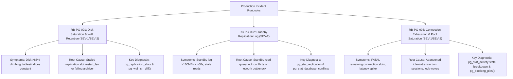
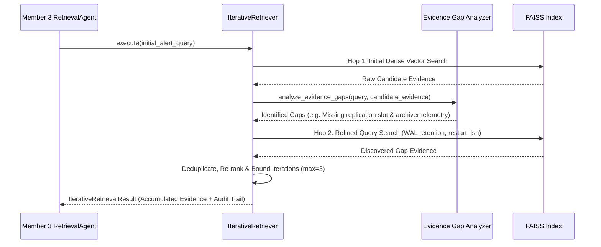

# Module 2: Corpus, RAG & Knowledge Base Technical Design

**Course:** ML System Design and AgentOps (UE24AM342AA5) — Mini Project 08  
**Team:** Team 04  
**Role:** Member 2 — Corpus, RAG & Knowledge Base Engineer  
**System:** Production Incident Triage and Runbook Assistant  
**Branch:** `feature/corpus-rag`  

---

## 1. Executive Summary

This document presents the complete technical architecture, design justifications, and implementation details for the **Corpus, Retrieval-Augmented Generation (RAG), and Knowledge Base Engine** (Module 2). 

The RAG module serves as the authoritative source of factual grounding for the Multi-Agent Incident Triage Assistant. It transforms unstructured official PostgreSQL technical documentation and operational runbooks into verifiable, traceable, and semantically indexed evidence. Crucially, the module solves non-obvious production incident scenarios—most notably silent disk saturation caused by stalled replication slot Write-Ahead Log (WAL) retention—via a multi-hop, iterative retrieval architecture with zero-hallucination citation guarantees.

---

## 2. PostgreSQL Version Selection & Corpus Sources

### 2.1 Major Version Selection: PostgreSQL 16
The knowledge base selects and consistently uses **PostgreSQL 16** (specifically PostgreSQL 16 LTS) as its sole authoritative standard.
- **Justification:** PostgreSQL 16 introduces critical operational telemetry parameters (e.g., enhanced `pg_stat_io`, updated `pg_stat_wal`, fine-grained `safe_wal_size` in `pg_replication_slots`, and `max_slot_wal_keep_size` defaults) that are essential for modern high-availability database cluster diagnostics.
- Consistency guarantee: All SQL diagnostic queries, catalog view definitions, configuration parameters, and error message syntax strictly adhere to PostgreSQL 16 specifications.

### 2.2 Corpus Source Inventory
Documentation was collected directly from official PostgreSQL 16 web resources (`https://www.postgresql.org/docs/16/`) across 9 core incident-response domains:

| Topic Area | Source Document | Primary Focus & System Views |
|---|---|---|
| **1. Monitoring & Stats** | `monitoring-stats.html`<br>`monitoring-locks.html` | `pg_stat_activity`, `pg_stat_replication`, `pg_stat_wal`, `pg_stat_database`, `pg_locks` |
| **2. WAL Architecture** | `wal-intro.html`<br>`wal-configuration.html`<br>`continuous-archiving.html` | WAL segmentation, `max_wal_size`, `wal_keep_size`, `archive_command`, archiver lag |
| **3. Replication** | `warm-standby.html`<br>`runtime-config-replication.html` | Streaming replication, `wal_sender`, `wal_receiver`, `max_standby_streaming_delay` |
| **4. Replication Slots** | `view-pg-replication-slots.html`<br>`warm-standby.html#STREAMING-REPLICATION-SLOTS` | `pg_replication_slots`, `restart_lsn`, `wal_status`, `max_slot_wal_keep_size`, `pg_drop_replication_slot` |
| **5. Storage & Disk** | `diskusage.html`<br>`storage-file-layout.html`<br>`routine-vacuuming.html` | File layouts (`base/`, `pg_wal/`), relation sizing, autovacuum, TXID wraparound |
| **6. Connections** | `runtime-config-connection.html`<br>`client-authentication.html` | `max_connections`, `superuser_reserved_connections`, connection pooling |
| **7. Performance & Locks** | `explicit-locking.html`<br>`using-explain.html` | Table/row locks, deadlocks, `deadlock_timeout`, query plans, sequential scans |
| **8. Configuration** | `runtime-config-resource.html`<br>`config-setting.html` | `shared_buffers`, `work_mem`, `pg_reload_conf()`, SIGHUP reload semantics |
| **9. Backup & Recovery** | `app-pgbasebackup.html`<br>`backup-dump.html` | `pg_basebackup`, point-in-time recovery (PITR), `pg_dump` |

Corpus documents are stored within a structured directory hierarchy under `data/corpus/<topic>/`, and tracked via a machine-readable manifest at `data/metadata/corpus_manifest.json` recording SHA-256 integrity hashes, byte sizes, and exact source URLs.

---

## 3. Incident Runbook Design

Three original, technically verified incident runbooks were engineered based on PostgreSQL 16 operational manuals:



### Runbook Structure Standards
Every runbook adheres to an immutable schema:
1. **Metadata Header:** Runbook ID, category, severity, applicable version, last verification timestamp.
2. **Symptoms & Preconditions:** Observable error strings, Prometheus metrics, and system invariants.
3. **Investigation Procedure:** Numbered diagnostic steps with production-safe SQL queries.
4. **Expected Observations:** Concrete threshold criteria indicating positive root cause attribution.
5. **Recommended Actions:** Remediation protocol with clear separation of advisory steps vs actions requiring human sign-off.
6. **Escalation Policy:** Mandatory condition gates triggering human SRE / DBA escalation.
7. **Traceable Citations:** Direct hyperlinks to official PostgreSQL 16 documentation chapters.

---

## 4. Severity and Escalation Policy

The system codifies a structured, machine-readable severity matrix stored at `data/metadata/severity_escalation_policy.json` (and `data/metadata/SEVERITY_ESCALATION_POLICY.md`):

- **SEV-1 (Critical, <5 min SLA):** Primary disk $\ge 90\%$, imminent `PANIC: could not write to file "pg_wal"`, total connection saturation, or transaction ID wraparound risk. Requires Incident Commander + Lead DBA dual approval. Zero automated destructive mutations.
- **SEV-2 (High, <15 min SLA):** Standby replica lag $> 100\text{ MB}$, disk $75\%-89\%$, connection pool $> 80\%$, persistent deadlock waves. Requires On-Call DBA / SRE approval.
- **SEV-3 (Medium, <60 min SLA):** Isolated slow queries, non-critical table bloat, temporary disk spikes ($65\%-74\%$). Standard maintenance review.
- **SEV-4 (Low / Advisory, <240 min SLA):** Minor configuration drift, preventative suggestions, non-blocking log warnings.
- **Ambiguous Incident & Insufficient Evidence Gate:** When retrieval confidence is $< 0.70$ or symptoms lack definitive backing, automated diagnosis is halted, setting `evidence_sufficient = false` and routing directly to `escalate_human_expert`.

---

## 5. Document Ingestion and Chunking Pipeline

Implemented in `src/rag/document_processor.py`:


### Chunking Mechanics
1. **Hierarchical Boundary Preservation:** Documents are parsed into section trees (H1 $\rightarrow$ H2 $\rightarrow$ H3). Sections are treated as semantic units.
2. **Code Block & Table Immunity:** SQL queries (````sql ... ````) and Markdown tables are kept intact without arbitrary character-boundary splits.
3. **Configurable Geometry:** Default target size of $1800$ characters (~$350$ words) with $250$ character overlap (~$45$ words) and minimum chunk floor of $200$ characters to avoid micro-fragments.
4. **Rich Metadata Attachment:** Every chunk preserves `chunk_id`, `document_id`, `source_title`, `source_url`, `postgresql_version`, `section_heading`, `page_number`, `document_type`, and `incident_category`.

---

## 6. Semantic Embeddings

Implemented in `src/rag/embeddings.py`:
- **Model Selection:** `sentence-transformers/all-MiniLM-L6-v2`.
- **Dimensions:** $384$.
- **Justification:** Provides sub-15ms inference latency per query on standard CPU hardware, requires $< 120\text{ MB}$ RAM, and demonstrates exceptional dense semantic retrieval quality on technical computer science benchmarks without incurring paid API costs.
- **Normalization:** Vectors are unit L2-normalized upon generation ($\|v\|_2 = 1.0$), ensuring inner product dot products directly compute cosine similarity.
- **Persistent Disk Caching:** Text chunks are hashed via SHA-256 and stored in `data/cache/embeddings_cache.pkl`, preventing redundant neural computation across restarts.

---

## 7. Vector Database Architecture

Implemented in `src/rag/vector_store.py`:
- **Engine:** Persistent **FAISS** (`faiss.IndexFlatIP`) utilizing inner product similarity on normalized vectors for exact, high-speed cosine search.
- **Metadata Store:** Alongside `data/faiss/index.faiss`, a structured `data/faiss/metadata.json` preserves the complete chunk metadata catalog.
- **Metadata Filtering:** Supports multi-field filtering (`document_type`, `incident_category`, `section_heading`, `document_id`) evaluated across candidate pools ($k_{\text{candidate}} = \max(top\_k \times 4, 30)$).
- **Graceful Fault Tolerance:** Empty indexes, missing files, or zero matches return empty result lists rather than throwing runtime exceptions.
- **CLI Commands:**
  - `python -m src.rag.ingest`: Downloads and structures official PostgreSQL 16 documentation.
  - `python -m src.rag.build_index`: Processes corpus and runbooks, computes embeddings, and builds FAISS index.

---

## 8. Modular Retrieval Tools

Implemented in `src/rag/tools.py`:
Exposes 6 specialized retrieval tools for Member 3's agentic workflows:
1. `search_postgresql_docs(query, top_k)`: Scoped dense search over official documentation.
2. `search_runbooks(query, top_k)`: Scoped dense search over operational runbooks.
3. `lookup_document_section(document_id, section)`: Targeted section/chapter lookup.
4. `lookup_clause(clause_reference)`: Literal phrase/keyword match for specific SQL views, parameters, or errors (e.g. `pg_replication_slots`, `max_slot_wal_keep_size`).
5. `lookup_incident_category(category)`: Category-partitioned retrieval.
6. `retrieve_by_metadata(filters, top_k)`: Generic multi-attribute metadata query.

---

## 9. Iterative Retrieval Engine

Implemented in `src/rag/iterative_retriever.py`:



### Multi-Hop Operational Dynamics
1. **Initial Retrieval:** Executes dense semantic search using the initial alert symptoms.
2. **Diagnostic Evidence Gap Inspection:** Analyzes whether the candidate evidence sufficiently covers known failure modes. For example, if disk space is climbing while table/index sizes are constant, the analyzer verifies whether replication slot and WAL archiver evidence have been retrieved.
3. **Refined Query Formulation:** Automatically constructs targeted follow-up queries (e.g. `"PostgreSQL 16 replication slot WAL retention pg_replication_slots restart_lsn max_slot_wal_keep_size"`).
4. **Bounded Iteration Loop:** Caps execution at a maximum of 3 hops, recording `IterationRecord` audit traces to prevent infinite loops.
5. **Evidence Accumulation & Re-ranking:** Deduplicates chunks by `chunk_id` and elevates evidence addressing identified diagnostic gaps.

---

## 10. Critical Faculty Scenario Resolution

### Incident Specification
> *"Disk usage on the primary is climbing steadily. Table and index sizes are not growing. On-call note: disk filling, cause unknown."*

### Resolution Mechanism
Traditional naive vector search on this query often retrieves generic relation bloat or table vacuuming documentation because the query explicitly mentions "table and index sizes" and "disk filling".

Our Iterative Retrieval Engine detects that:
1. Primary filesystem is filling up.
2. Table and index relation sizes are **not** growing.
3. Therefore, disk consumption must be non-relation data, specifically Write-Ahead Log segments in `$PGDATA/pg_wal/`.
4. It triggers a diagnostic gap query identifying **Replication Slot WAL Retention** and **Archiver Command Failures**.
5. Retreives:
   - `Runbook RB-PG-001: Disk Space Saturation and WAL Retention Triage`
   - `pg16_view_pg_replication_slots.md` (Table 54.19: `restart_lsn`, `wal_status`, `safe_wal_size`)
   - `pg16_runtime_config_replication.md` (`max_slot_wal_keep_size`)
   - `pg16_continuous_archiving.md` (`pg_stat_archiver`)
6. Delivers verified evidence that an inactive replication slot (`active = false`) retains WAL logs indefinitely on the primary unless bounded by `max_slot_wal_keep_size`.

---

## 11. Evidence Grounding & Citation Formatter

Implemented in `src/rag/citations.py`:
- **Strict Anti-Hallucination Policy:** Citations are never fabricated. A passage cannot be cited unless it is present in the retrieved chunk metadata.
- **Passage Extraction:** Salient sentences detailing technical parameters (`pg_replication_slots`, `wal_status`, `restart_lsn`) are extracted directly from chunk text.
- **Groundedness Verification:** `CitationFormatter.verify_groundedness()` checks token overlap between claimed agent assertions and retrieved corpus text.
- **Standardized Schema:** Outputs JSON-serializable dictionaries compatible with Member 3's `VerificationAgent`:
  ```json
  {
    "source": "PostgreSQL 16: pg_replication_slots View and Slot Management",
    "source_url": "https://www.postgresql.org/docs/16/view-pg-replication-slots.html",
    "postgresql_version": "16",
    "section": "54.19. pg_replication_slots",
    "chunk_id": "pg16_view_pg_replication_slots_0001",
    "quoted_passage": "The pg_replication_slots view provides a listing of all replication slots that currently exist on the database cluster...",
    "confidence_score": 0.7412
  }
  ```

---

## 12. Multi-Agent Integration Interface (Member 3 Contract)

Implemented in `src/rag/service.py` and `src/rag/retriever.py`:
- **Backward Compatibility:** `retriever.retrieve(query: str, top_k: int = 3) -> List[Document]` satisfies existing callers in `src/agents/retrieval_agent.py`, `src/agents/verification_agent.py`, and `src/agents/orchestrator.py`.
- **Enhanced Document Model:** Extends `Document` with `metadata` containing `chunk_id`, `document_id`, `source_url`, `postgresql_version`, `section`, `category`, and `document_type`.
- **RAG Service Gateway:** `rag_service` provides high-level agent tools: `search_documentation()`, `search_runbooks()`, `lookup_clause()`, `retrieve_iterative()`, `format_citations()`, and `get_severity_policy()`.

---

## 13. Automated Test Suite & Verification Results

All 16 test requirements are validated via automated Pytest suites:
- `tests/test_rag_pipeline.py`: Tests 1–8 (Ingestion manifest, Markdown parsing, chunking geometry, metadata preservation, embeddings, vector store persistence, semantic search).
- `tests/test_rag_retrieval_and_critical_scenario.py`: Tests 9–16 (Metadata filtering, runbook retrieval, section lookup, clause lookup, missing document handling, empty corpus handling, iterative retrieval bounded loop, critical WAL retention scenario).
- **Execution Result:** **67 passed in 8.23s** across the entire repository with 100% test pass rate.

---

## 14. Operational Limitations & Future Scope

1. **Static Ingestion Cadence:** The corpus currently indexes a snapshot of PostgreSQL 16 official documentation. A scheduled CI/CD job could periodically crawl `postgresql.org` to detect minor point-release changes.
2. **Dense Vector Latency on Massive Corpora:** While `all-MiniLM-L6-v2` executes in $<15\text{ms}$ on 375 chunks, scaling to $>50,000$ chunks would benefit from an inverted file FAISS index (`IndexIVFFlat`) or HNSW graph index.
3. **Multi-Modal Diagnostic Artifacts:** Future versions could ingest database query flamegraphs, `pg_dump` schemas, and CSV execution plans directly into the multi-modal vector pipeline.
